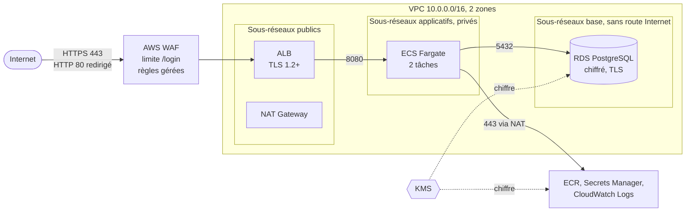
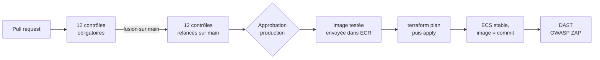

# DevSecOps-Project

Challenge final DevSecOps : intégrer et déployer de manière sécurisée une application Python (Flask) dans une pipeline CI/CD, en appliquant les principes DevSecOps.

## Sommaire

1. [Contenu du dépôt](#contenu-du-dépôt)
2. [Gestion sécurisée du versioning](#gestion-sécurisée-du-versioning)
3. [Sécurisation du code source](#sécurisation-du-code-source)
4. [Image Docker et pipeline CI](#image-docker-et-pipeline-ci)
5. [Déploiement sécurisé sur AWS](#déploiement-sécurisé-sur-aws) *(en cours)*
6. [Stockage sécurisé des mots de passe](#stockage-sécurisé-des-mots-de-passe)
7. Architecture et cycle de vie sécurisé *(à venir)*

## Contenu du dépôt

- `app/app/main.py` : application Flask (vérification d'un mot de passe, création de compte, connexion).
- `app/app/security.py` : hachage Argon2id et règles de validation des identifiants et mots de passe.
- `app/app/models.py` : modèle utilisateur et accès à la base de données (SQLAlchemy).
- `app/app/templates/` : pages HTML (Jinja2, échappement automatique).
- `app/app/data/` : listes SecLists embarquées (500 et 10 000 mots de passe les plus courants).
- `app/app/gunicorn.conf.py` : configuration du serveur de production Gunicorn.
- `app/app/requirements.txt` : dépendances Python, versions figées.
- `Dockerfile` : construction de l'image Docker (multi-étapes, durcie).
- `.dockerignore` : liste blanche des fichiers envoyés au build Docker.
- `tests/unit/` : tests unitaires (pytest).
- `tests/container/smoke_test.sh` : tests de fonctionnement et de sécurité du conteneur.
- `infra/bootstrap/` : ressources permanentes : script de création des buckets S3 (`create-buckets.sh`), configuration de sécurité de l'état Terraform (clé KMS, chiffrement, versioning, journaux d'accès), bucket des journaux de l'infrastructure, dépôt d'images ECR, et leurs tests.
- `infra/platform/` : infrastructure de l'application (VPC, ALB, WAF, ECS Fargate, RDS, Secrets Manager, CloudWatch) et ses tests ; détruite en fin de session.
- `.github/workflows/ci.yml` : pipeline CI/CD GitHub Actions (analyses, construction, tests, déploiement sur AWS, analyse dynamique).
- `.zap/rules.tsv` : alertes OWASP ZAP ignorées, chacune avec sa justification.
- `.github/dependabot.yml` : mises à jour automatiques des dépendances, de l'image de base, des actions et des fournisseurs Terraform.
- `CLAUDE.md` : contexte du projet pour l'assistant IA Claude Code (règles de travail, état d'avancement, contraintes AWS). Il permet de reprendre le travail sur une autre machine et documente de façon transparente l'usage de l'IA : l'assistant a rédigé le code et la documentation en expliquant chaque choix ; les commits, les push, les fusions et la configuration GitHub ont été faits par l'auteur.

## Gestion sécurisée du versioning

### Plateforme

Le dépôt est hébergé sur **GitHub** et la CI/CD utilisera **GitHub Actions**. Les activités du cours utilisaient GitLab CI ; les outils de sécurité étudiés (Flake8, Bandit, Semgrep, Trivy, Hadolint, Dockle, ZAP, Checkov, TruffleHog) s'exécutent de la même façon dans GitHub Actions.

### Signature des commits

Tous les commits sont signés avec une clé SSH **ed25519**, déclarée sur GitHub comme clé de signature (*Signing Key*). GitHub les affiche comme **Verified**, ce qui garantit que l'auteur affiché est bien celui qui a produit le commit.

- ed25519 plutôt que RSA 2048 : clé plus courte, plus rapide, et niveau de sécurité équivalent ou supérieur.
- Un fichier `allowed_signers` permet aussi de vérifier les signatures en local (`git log --show-signature`).
- Les deux premiers commits (import de l'application de départ) sont antérieurs à cette configuration et ne sont pas signés. Ils n'ont pas été réécrits : modifier un historique déjà publié est une mauvaise pratique.

### Protection de la branche `main`

Un *ruleset* GitHub (`protect-main`) s'applique à la branche par défaut, **sans aucune exception** (liste de contournement vide, y compris pour le propriétaire du dépôt).

| Règle | Effet |
|---|---|
| Restrict deletions | `main` ne peut pas être supprimée |
| Block force pushes | l'historique de `main` ne peut pas être réécrit |
| Require signed commits | tout commit non signé est refusé |
| Require a pull request before merging | aucun push direct : toute modification passe par une pull request |
| Require conversation resolution | une PR ne peut pas être fusionnée tant qu'une discussion reste ouverte |
| Méthodes de fusion : merge et squash | le *rebase merge* est désactivé, car GitHub ne peut pas signer les commits rebasés |
| Require status checks to pass | une PR ne peut être fusionnée que si les jobs obligatoires de la pipeline réussissent |
| Require branches to be up to date | la PR doit être testée sur la dernière version de `main` avant la fusion |

**Nombre d'approbations requis : 0.** Le projet est réalisé seul et GitHub interdit d'approuver sa propre pull request ; exiger une approbation bloquerait toute fusion. Dans une équipe, ce nombre serait fixé à au moins 1.

**Vérifications obligatoires** (*required status checks*), ajoutées au fur et à mesure que chaque job de la pipeline est au vert :

| Check obligatoire | Rôle | Ajouté après |
|---|---|---|
| `Lint (Flake8)` | qualité du code | PR #2 (audit du code) |
| `SAST (Bandit)` | analyse statique de sécurité | PR #2 |
| `SAST (Semgrep)` | analyse statique de sécurité | PR #2 |
| `SCA (pip-audit)` | vulnérabilités des dépendances | PR #2 |
| `Lint Dockerfile (Hadolint)` | bonnes pratiques du Dockerfile | PR #4 (image Docker) |
| `Build (image Docker)` | construction de l'image | PR #4 |
| `Tests du conteneur` | fonctionnement et durcissement du conteneur | PR #4 |
| `Scan image (Trivy)` | vulnérabilités de l'image | PR #4 |
| `Scan image (Dockle)` | CIS Docker Benchmark | PR #4 |
| `Tests unitaires (pytest)` | logique de l'application, stockage des mots de passe | PR du stockage des mots de passe |
| `IaC Terraform (fmt, validate, test)` | format, validité et tests de l'infrastructure | PR du backend Terraform |
| `IaC (Checkov)` | mauvaises configurations de l'infrastructure | PR du backend Terraform |

Ces checks sont rattachés à **GitHub Actions** : un autre outil ou un statut posé à la main ne peut pas les satisfaire. La sécurité devient une **condition bloquante** de la livraison : aucune modification n'arrive sur `main` si un scan échoue, et la règle s'applique aussi au propriétaire du dépôt.

**Méthode de fusion utilisée : merge commit.** Elle conserve chaque commit de la branche dans l'historique de `main`, ce qui garde valides les références de commits citées dans ce README (un *squash* les regrouperait en un seul).

### Workflow de branches

```
main (protégée)
 ├── docs/...   documentation
 ├── fix/...    corrections de sécurité
 ├── ci/...     pipeline CI/CD
 └── feat/...   nouvelles fonctionnalités
```

1. Créer une branche depuis `main` (`git switch -c fix/...`).
2. Faire des commits signés, en suivant la convention de nommage ci-dessous.
3. Pousser la branche et ouvrir une pull request vers `main` (en brouillon tant que le travail est en cours).
4. Fusionner une fois la pipeline au vert et les discussions résolues.

### Convention des messages de commit

Format : `[TYPE]-> description courte`

| Type | Usage | Exemple |
|---|---|---|
| `[FILE]` | ajout ou import de fichiers | `[FILE]-> Import app.py` |
| `[CONF]` | configuration (CI, Git, outils) | `[CONF]-> ci.yml, scan lint, SAST, SCA` |
| `[FIX]` | correction de bug ou de vulnérabilité | `[FIX]-> Flask 3.1.3 (PYSEC-2023-62)` |
| `[DOCS]` | documentation | `[DOCS]-> README, section versioning` |
| `[STYLE]` | formatage sans changement de comportement | `[STYLE]-> conformité Flake8` |
| `[TEST]` | ajout ou modification de tests | `[TEST]-> tests de la route /password` |

Pour une correction de vulnérabilité, le message cite l'identifiant concerné (CWE, PYSEC, règle Bandit ou Semgrep) et, si une issue existe, la référence en seconde ligne (`Closes #N`).

Les deux commits de documentation du début (`docs: ...`) sont antérieurs à l'adoption de cette convention.

## Sécurisation du code source

### Démarche

1. La pipeline CI a été mise en place **avant** toute correction : sa première exécution sur le code d'origine (PR #2, run CI #1) a échoué sur les 4 analyses et sert de constat initial.
2. Chaque vulnérabilité est corrigée dans un commit dédié, sur la branche `fix/audit-code`. À chaque push, la pipeline se relance et montre l'effet de la correction.
3. Les points que les outils ne voient pas ont été relevés par une relecture manuelle du code.

### Analyses automatiques (pipeline CI)

Fichier : `.github/workflows/ci.yml`. La pipeline s'exécute à chaque pull request vers `main` et à chaque push sur `main`.

| Job | Outil | Type d'analyse | Ce qu'il vérifie |
|---|---|---|---|
| Lint (Flake8) | Flake8 | qualité | style et erreurs de syntaxe (PEP 8) |
| SAST (Bandit) | Bandit | SAST | failles de sécurité connues dans le code Python |
| SAST (Semgrep) | Semgrep (`p/python`, `p/flask`) | SAST | règles de sécurité Python et spécifiques à Flask |
| SCA (pip-audit) | pip-audit | SCA | vulnérabilités connues (CVE, PYSEC) dans les dépendances |

Choix de configuration :

- `permissions: contents: read` : le jeton de la pipeline ne peut que lire le dépôt (moindre privilège).
- `concurrency` avec `cancel-in-progress` : un nouveau push annule l'exécution en cours sur la même branche ; seul le résultat du dernier commit compte.
- Jobs indépendants et parallèles : un échec est immédiatement attribuable à un outil.
- Semgrep tourne dans son image Docker officielle (il ne fonctionne pas nativement sous Windows).
- En complément, **Dependabot** surveille en continu les dépendances du dépôt et ouvre des alertes dans l'onglet *Security*.

### Constat initial

| # | Vulnérabilité | Détectée par | Identifiant | Gravité |
|---|---|---|---|---|
| 1 | Flask 2.2.2 vulnérable | pip-audit, Dependabot | PYSEC-2023-62, PYSEC-2026-2151 | haute |
| 2 | Requêtes HTTP sans timeout | Bandit | B113, CWE-400 | moyenne |
| 3 | Téléchargement des listes à chaque requête (déni de service, dépendance à un site externe) | relecture | CWE-400 | moyenne |
| 4 | Vérification par sous-chaîne : `"a"` déclaré « mauvais mot de passe » | relecture | logique | moyenne |
| 5 | Écoute sur toutes les interfaces, serveur de développement Flask | Bandit, Semgrep | B104, CWE-605 | moyenne |
| 6 | Champ mot de passe en clair (`type="text"`) | relecture | CWE-549 | faible |
| 7 | Formulaire envoyé vers une URL fixe en HTTP | relecture | CWE-319 | faible |
| 8 | Aucune protection CSRF sur le formulaire | relecture | CWE-352 | moyenne |
| 9 | Aucune validation de l'entrée (vide, longueur) | relecture | CWE-20 | faible |
| 10 | Dépendance `requests` utilisée mais non déclarée | relecture | — | faible |
| 11 | 74 écarts de style (indentation, espaces, longueur de ligne) | Flake8 | PEP 8 | — |

### Corrections

| # | Correction | Commit |
|---|---|---|
| 1 | Flask mis à jour en **3.1.3** (version corrigeant les deux vulnérabilités), version figée avec `==`. Le job SCA passe au vert. | `[FIX]-> Flask 3.1.3 (PYSEC-2023-62, PYSEC-2026-2151)` |
| 2, 3, 4, 10 | Listes SecLists **embarquées** dans `app/app/data/` et chargées une seule fois au démarrage dans un `frozenset`, avec une **comparaison exacte**. Plus aucun appel réseau, donc plus de `requests` (dépendance retirée). | `6e86286` `[FIX]-> Listes SecLists embarqués, comparaison exacte` |
| 6, 7, 9 | Formulaire : champ `type="password"`, URL d'envoi générée par `url_for` (relative), `required` et `maxlength`. Validation **côté serveur** : mot de passe vide, absent ou de plus de 128 caractères refusé avec un code `400`. | `3cfa81c` `[FIX]-> formulaire et validation des entrées` |
| 5 | Serveur de production **Gunicorn** (`gunicorn.conf.py`), écoute par défaut sur `127.0.0.1` ; le serveur de développement Flask (`app.run`) est limité à `127.0.0.1`. Bandit et Semgrep ne signalent plus rien. | `28d7853` `[FIX]-> Gunicorn, fin de l'écoute sur 0.0.0.0` |
| 8 | Protection **CSRF** avec Flask-WTF (`CSRFProtect`), jeton caché dans le formulaire, **clé secrète** fournie par l'environnement (obligatoire), cookie de session `Secure`, `HttpOnly`, `SameSite=Lax`. | `676c90e` `[FIX]-> protection CSRF, clé secrète, cookie de session` |
| 11 | Code reformaté selon PEP 8 (indentation de 4 espaces, espaces parasites, lignes vides, longueur de ligne). Aucun changement de comportement. Flake8 ne signale plus rien. | `[STYLE]-> conformité Flake8 (PEP 8)` |

Détails de la correction des listes :

- Les fichiers proviennent d'un **commit figé** de SecLists (`913b327317496d062bcc7cace524aaad8a693be2`) et non de la branche `master`, qui peut changer à tout moment.
- Empreintes SHA-256 vérifiées au téléchargement :

  | Fichier | SHA-256 |
  |---|---|
  | `500-worst-passwords.txt` | `91ae15ff637c9187aa102dc180952840523a5eed024392c5d038e0305e658608` |
  | `10k-most-common.txt` | `68782d6a4a19a4768d5f15dd66bd534e7a33055cc755411e33f16d18c50fdcce` |

- Vérifié : `password` est détecté (liste des 500), `1124` est détecté (liste des 10 000), `a` n'est plus un faux positif.

Détails de la correction du formulaire :

- **Champ masqué** (`type="password"`) : la saisie n'est plus visible à l'écran ni proposée par l'auto-complétion en clair.
- **URL relative** (`url_for('password')`, rendu `/password`) : l'ancien `http://localhost:8080/password` ne fonctionnait qu'en local et forçait le HTTP. L'URL relative suit le protocole de la page, donc HTTPS une fois déployé.
- **Validation côté serveur** : `required` et `maxlength` dans le HTML ne sont qu'un confort, contournable avec `curl`. La vraie vérification est faite dans la route Flask. La limite de 128 caractères évite aussi de traiter des entrées démesurées.
- Vérifié : vide → `400`, champ absent → `400`, 200 caractères → `400`, 128 caractères → `200`, `password` → détecté.

Détails de la correction du serveur (point 5) :

- **Le problème** : `app.run(host='0.0.0.0')` lançait le serveur de développement de Flask, qui n'est pas conçu pour la production (un seul processus, pas de limites, pas de gestion des requêtes bloquées), sur toutes les interfaces réseau de la machine.
- **Gunicorn** (version figée `27.0.0`, sans vulnérabilité connue selon pip-audit) sert l'application en production : `gunicorn main:app`, lancé depuis `app/app/`, lit automatiquement `gunicorn.conf.py`.
- **Adresse d'écoute sûre par défaut** : `127.0.0.1:8080`. Elle n'est ouverte (`0.0.0.0:8080`) que par la variable d'environnement `GUNICORN_BIND`, qui sera définie **uniquement dans l'image Docker**. Un conteneur doit écouter sur toutes ses interfaces pour être joignable ; l'exposition réelle est alors contrôlée par le réseau (security group, load balancer), pas par l'application. Ce choix est explicite et documenté plutôt que masqué par un `# nosec`.
- **Configuration de durcissement** :

  | Paramètre | Valeur | Rôle |
  |---|---|---|
  | `workers` | 2 (variable `GUNICORN_WORKERS`) | plusieurs processus : un worker bloqué ne rend pas le service indisponible |
  | `timeout` | 30 s | une requête bloquée est interrompue et son worker relancé |
  | `limit_request_line` | 4094 octets | ligne de requête limitée |
  | `limit_request_fields` | 50 | nombre d'en-têtes limité |
  | `limit_request_field_size` | 8190 octets | taille d'un en-tête limitée |
  | `accesslog`, `errorlog` | sortie standard | journaux récupérés par Docker puis par AWS |

- Gunicorn ne fonctionne pas sous Windows : il sera testé dans le conteneur Docker, lors de l'étape de la pipeline qui valide l'image.

Détails de la correction CSRF (point 8) :

- **Le risque** : sans protection, un site malveillant peut faire envoyer le formulaire par le navigateur d'un visiteur à son insu (*Cross-Site Request Forgery*).
- **Jeton CSRF** : Flask-WTF (version figée `1.3.0`, sans vulnérabilité connue selon pip-audit) ajoute à chaque formulaire un jeton aléatoire, signé et lié à la session. Toute requête `POST` sans jeton valide est refusée avec un code `400`. Un autre site ne peut pas lire ce jeton, donc ne peut pas forger la requête.
- **Clé secrète** (`SECRET_KEY`) : elle signe les jetons et le cookie de session. Elle n'est **jamais écrite dans le code ni dans le dépôt** : elle est lue dans l'environnement et sera fournie en production par un gestionnaire de secrets AWS. Si elle est absente, l'application **refuse de démarrer** (*fail fast*) plutôt que de tourner avec une clé faible ou prévisible.
- **Cookie de session durci** :

  | Attribut | Effet |
  |---|---|
  | `HttpOnly` | illisible par JavaScript, ce qui limite le vol de session en cas de faille XSS |
  | `SameSite=Lax` | non envoyé par les requêtes `POST` venant d'autres sites (seconde barrière contre le CSRF) |
  | `Secure` | envoyé uniquement en HTTPS ; désactivable en local avec `SESSION_COOKIE_SECURE=false` |

- Vérifié : sans `SECRET_KEY` → démarrage refusé ; `POST` sans jeton → `400` ; jeton falsifié → `400` ; jeton valide → réponse normale ; cookie émis avec `Secure; HttpOnly; SameSite=Lax`.

Lancer l'application en local (développement, HTTP) :

```bash
cd app/app
SECRET_KEY=$(python -c "import secrets; print(secrets.token_hex(32))") SESSION_COOKIE_SECURE=false python main.py
```

Détails de la correction du style (point 11) :

- Les 74 remarques Flake8 d'origine venaient surtout d'une indentation à 2 espaces, d'espaces en fin de ligne et de lignes vides manquantes. Une partie a disparu au fil des corrections précédentes, le code réécrit étant déjà conforme ; les 24 restantes ont été corrigées dans un commit à part.
- Ce reformatage est volontairement **isolé** des corrections de sécurité : les diffs de sécurité restent lisibles, et ce commit ne change aucun comportement (vérifié : mêmes réponses sur `/`, `password`, `1124`, `a` et mot de passe vide).
- La longueur de ligne par défaut de PEP 8 (79 caractères) est conservée ; les longs messages sont découpés en chaînes concaténées.

### Bilan de l'audit du code

| Job de la pipeline | Constat initial (run CI #1) | Après corrections |
|---|---|---|
| Lint (Flake8) | ❌ 74 remarques | ✅ 0 |
| SAST (Bandit) | ❌ 3 problèmes (B113 ×2, B104) | ✅ 0 |
| SAST (Semgrep) | ❌ 1 problème (`avoid_app_run_with_bad_host`) | ✅ 0 |
| SCA (pip-audit) | ❌ Flask 2.2.2 vulnérable | ✅ aucune vulnérabilité connue |

Les 11 problèmes relevés (outils et relecture manuelle) sont corrigés.

## Image Docker et pipeline CI

### Le Dockerfile

L'image est construite en **deux étapes** (*multi-stage build*) à partir d'une même image de base :

1. **`builder`** : crée un environnement virtuel `/opt/venv` et y installe les dépendances de `requirements.txt`.
2. **`runtime`** : image finale, qui ne reçoit que l'environnement virtuel et le code de l'application.

| Mesure | Détail | Pourquoi |
|---|---|---|
| Image de base minimale | `python:3.15.0-slim-trixie` | moins de paquets système, donc moins de vulnérabilités et de surface d'attaque |
| Base figée par **digest** | `@sha256:f5b92f2a…` | l'image construite est toujours la même ; une image modifiée sur le registre ne correspondrait plus à l'empreinte |
| Utilisateur dédié **non root** | `app`, uid 10001, sans shell (`nologin`) ni répertoire personnel ; déclaré par identifiant numérique (`USER 10001:10001`) | un attaquant qui prendrait le contrôle de l'application n'aurait aucun privilège ; l'identifiant numérique permet de vérifier « non root » sans lire `/etc/passwd` (Hadolint DL3066) |
| Code en lecture seule | fichiers appartenant à `root`, l'utilisateur `app` ne peut que les lire | l'application ne peut pas modifier son propre code |
| **pip retiré** de l'image finale | désinstallé du système et de l'environnement virtuel | rien ne peut être installé dans le conteneur en production |
| Bits **setuid/setgid retirés** | `find / -xdev -perm /6000 -exec chmod a-s` | aucun binaire (`su`, `passwd`, `mount`…) ne peut s'exécuter avec les droits root |
| Correctifs Debian appliqués | `zlib1g`, `apt` et `libapt-pkg7.0` mis à jour en versions corrigées figées | voir les corrections ci-dessous |
| Pas de cache pip | `--no-cache-dir` | image plus petite, pas de fichiers inutiles |
| Secrets absents de l'image | `SECRET_KEY` fournie au lancement uniquement | une image publiée ou volée ne contient aucun secret |
| Serveur de production | `CMD ["gunicorn", "main:app"]`, `GUNICORN_BIND=0.0.0.0:8080` | voir la correction du point 5 ; seul le conteneur ouvre l'écoute |
| `HEALTHCHECK` | requête sur `/` toutes les 30 s | Docker, puis AWS, détectent un conteneur qui ne répond plus |
| `.dockerignore` en liste blanche | seul `app/app/` est envoyé au build | `.git`, `.venv`, la configuration CI ou un éventuel fichier de secrets ne peuvent pas entrer dans l'image par erreur |
| Métadonnées OCI | `LABEL org.opencontainers.image.*` | traçabilité de l'image vers le dépôt source |

### Les jobs Docker de la pipeline

```
Lint Dockerfile (Hadolint)

Build (image Docker) ──┬── Tests du conteneur
                       ├── Scan image (Trivy)
                       └── Scan image (Dockle)
```

L'image est construite **une seule fois** (`docker build --pull --no-cache`), exportée en fichier (`docker save`) et transmise aux trois jobs suivants comme artefact (conservé 1 jour). Les tests et les scans portent donc exactement sur la même image.

| Job | Outil | Ce qu'il vérifie | Échoue si |
|---|---|---|---|
| Lint Dockerfile | Hadolint `v2.15.1` | bonnes pratiques d'écriture du Dockerfile | une règle Hadolint n'est pas respectée |
| Build | Docker | l'image se construit | erreur de construction |
| Tests du conteneur | `tests/container/smoke_test.sh` | fonctionnement et durcissement réels du conteneur (voir ci-dessous) | un test échoue |
| Scan image (Trivy) | Trivy `0.76.2` | vulnérabilités des paquets système et Python de l'image | vulnérabilité **HIGH** ou **CRITICAL** ayant un correctif |
| Scan image (Dockle) | Dockle `v0.4.15` | conformité au CIS Docker Benchmark | alerte de niveau **WARN** ou plus (une exception justifiée, voir ci-dessous) |

Trivy utilise `--ignore-unfixed` : une vulnérabilité sans correctif publié ne peut pas être corrigée par une mise à jour, la bloquer empêcherait toute livraison sans gain de sécurité. Elle reste visible dans le rapport.

### Tests du conteneur

Le conteneur est lancé **comme en production, durci** : système de fichiers en lecture seule (`--read-only`, seul `/tmp` est inscriptible), aucune capacité Linux (`--cap-drop ALL`), pas d'élévation de privilèges (`no-new-privileges`), et une `SECRET_KEY` aléatoire générée pour le test.

| # | Test | Résultat attendu |
|---|---|---|
| 1 | Démarrage sans `SECRET_KEY` | refusé |
| 2 | Requête sur `/` | Gunicorn répond |
| 3 | `id -u` dans le conteneur | différent de 0 (non root) |
| 4 | `python -m pip` | absent |
| 5 | Écriture dans `/app/main.py` | impossible |
| 6 | Fichiers dans `/var/lib/apt/lists` | aucun (cache apt vide) |
| 7 | Binaires setuid/setgid | aucun |
| 8 | `POST /password` sans jeton CSRF | `400` |
| 9 | Formulaire, jeton CSRF et mot de passe `password` | champ masqué, mot de passe détecté |
| 10 | Mot de passe vide avec jeton valide | `400` |

### Corrections issues de la première exécution

Sur la première exécution de la pipeline (PR `feat/docker`), le build et les tests du conteneur étaient au vert, mais les trois scanners ont bloqué :

| Outil | Constat | Correction |
|---|---|---|
| Hadolint | `DL3066` (info) : `USER app`, utilisateur désigné par son nom | `USER 10001:10001` : l'identifiant numérique permet de vérifier « non root » sans lire `/etc/passwd` |
| Trivy | 2 vulnérabilités **HIGH** dans `zlib1g` `1:1.3.dfsg+really1.3.1-1+b1` (CVE-2026-85091, débordement de tas dans `gz_vacate()` permettant l'exécution de code ; CVE-2026-76844), corrigées dans `…-1+deb13u1`, publiée après l'image de base. Toutes les dépendances Python : 0 vulnérabilité. | Mise à jour ciblée de `zlib1g` vers la version corrigée **figée**, plutôt qu'un `apt-get upgrade` global non reproductible. À retirer quand Dependabot proposera une image de base qui l'inclut. |
| Dockle | `DKL-DI-0005` (FATAL) : cache apt non vidé | **Faux positif**, ignoré explicitement (`--ignore DKL-DI-0005`). La couche signalée est celle de l'image officielle Python, qui vide le cache avec `apt-get dist-clean`, commande que Dockle v0.4.15 ne reconnaît pas. L'absence de cache apt est **prouvée** par le test n° 6 du conteneur. |
| Dockle | `CIS-DI-0008` (info) : 11 binaires setuid/setgid (`su`, `passwd`, `mount`…) | Non bloquant, mais corrigé par défense en profondeur : bits retirés dans l'image, vérifié par le test n° 7. |
| Dockle | `CIS-DI-0005` (info) : Docker Content Trust non activé | Non bloquant, non appliqué : Docker Content Trust (Notary v1) est abandonné. L'intégrité de l'image de base est garantie par son **digest** figé dans le `Dockerfile`. |

Une alerte n'est jamais masquée sans justification : chaque exception est commentée dans `ci.yml`, documentée ici, et couverte par un test qui prouve que le risque est absent.

### Passage à Python 3.15 (PR Dependabot #5)

Dependabot a proposé l'image `python:3.15.0-slim-trixie`. Tous les checks passaient (tests unitaires et tests du conteneur compris), sauf Trivy :

| Outil | Constat | Correction |
|---|---|---|
| Trivy | 2 vulnérabilités **HIGH** : `apt` et `libapt-pkg7.0` `3.0.3` (CVE-2026-109518, exécution de code à distance par réutilisation de liens physiques pendant le téléchargement des paquets), corrigées en `3.0.4`. L'image 3.15.0 a été construite avant ce correctif, alors que l'image 3.13.18 l'incluait déjà. | Même méthode que pour `zlib1g` : mise à jour ciblée vers la version corrigée **figée** (`apt=3.0.4`, `libapt-pkg7.0=3.0.4`). À retirer quand Dependabot proposera une image 3.15 qui l'inclut. |

La PR Dependabot n'a pas été fusionnée telle quelle : la montée de version et le correctif sont regroupés dans la branche `fix/python-3.15`, et la version de Python des jobs CI (lint, tests, SAST, SCA) passe aussi à 3.15 pour analyser le code avec la même version que l'image. La ligne `zlib1g` reste nécessaire : l'image 3.15.0 contient toujours la version vulnérable.

### Sécurité de la chaîne CI elle-même

- **Actions figées par SHA** (`actions/checkout@3d3c42e…  # v7.0.1`) : un tag peut être déplacé vers du code malveillant, une empreinte de commit non. Les versions sont rappelées en commentaire.
- **Outils figés par version** (Flake8, Bandit, pip-audit, Semgrep, Hadolint, Trivy, Dockle) : un même code donne toujours le même résultat de scan.
- **`persist-credentials: false`** : le jeton GitHub n'est pas laissé dans le dépôt cloné, les étapes suivantes ne peuvent pas le réutiliser.
- **Dependabot** (`.github/dependabot.yml`) propose chaque semaine les mises à jour des dépendances Python, de l'image de base et des actions. Chaque mise à jour arrive en pull request et doit passer les checks obligatoires.

## Déploiement sécurisé sur AWS

### Environnement et contraintes

Le déploiement cible un compte **AWS Academy Learner Lab**, région `us-east-1`. Ce bac à sable impose des limites qui orientent plusieurs choix :

| Contrainte du lab | Conséquence | En production |
|---|---|---|
| Identifiants **temporaires** (environ 4 h), renouvelés à chaque session | stockés dans `~/.aws/credentials` en local et dans les secrets GitHub pour la pipeline, à renouveler à chaque session ; jamais écrits dans le dépôt | fédération **OIDC** GitHub → AWS : aucun identifiant stocké, jeton de courte durée par exécution |
| Création de **rôles IAM** et de fournisseur OIDC interdite | utilisation du rôle imposé `LabRole` pour ECS ; pas de réplication S3 inter-régions | un rôle par usage (exécution ECS, tâche, déploiement), chacun limité au strict nécessaire |
| Pas de nom de domaine | HTTPS avec un certificat **auto-signé** importé dans ACM (avertissement du navigateur) | certificat ACM validé par DNS sur un domaine de l'entreprise |
| Une **SCP** (politique de l'organisation AWS Academy) refuse `s3:GetBucketObjectLockConfiguration` | les buckets S3 sont créés par un script AWS CLI ; Terraform applique toute leur configuration de sécurité (voir l'étape 1) | ressource `aws_s3_bucket` gérée entièrement par Terraform |
| Budget limité | un seul NAT Gateway au lieu d'un par zone ; infrastructure détruite en fin de session (`terraform destroy`) | un NAT par zone pour la haute disponibilité |

### Architecture cible

L'infrastructure est entièrement décrite en **Terraform** (*Infrastructure as Code*) : elle est relue en pull request, analysée par Checkov et reproductible.

- **Réseau** : VPC sur 2 zones de disponibilité ; sous-réseaux publics pour l'ALB, privés pour ECS et RDS ; NAT Gateway pour les sorties (ECR, Secrets Manager, CloudWatch).
- **Entrée** : Application Load Balancer en **HTTPS** (HTTP redirigé vers HTTPS), protégé par **AWS WAF** (règles gérées AWS et limitation de débit sur `/login` contre la force brute).
- **Application** : **ECS Fargate**, 2 tâches réparties sur 2 zones ; leur groupe de sécurité n'accepte que le trafic venant de l'ALB.
- **Base de données** : **RDS PostgreSQL** chiffré, privé, n'acceptant que les tâches ECS. Mot de passe généré et stocké par AWS dans Secrets Manager (`manage_master_user_password`), jamais connu de Terraform.
- **Secrets** : **Secrets Manager** pour `SECRET_KEY` et le mot de passe de la base, injectés dans les conteneurs au démarrage (jamais dans l'image ni dans le dépôt).
- **Images** : **ECR** avec scan à l'envoi et tags immuables (une image publiée ne peut pas être remplacée).
- **Journaux** : **CloudWatch Logs** pour les conteneurs et le WAF ; bucket S3 pour l'ALB et les flux réseau du VPC.



### Plan de réalisation

Le déploiement est découpé en trois pull requests, chacune analysée par la pipeline :

| Étape | Branche | Contenu | Critère |
|---|---|---|---|
| 1 | `feat/terraform-backend` | stockage sécurisé de l'état Terraform, jobs Terraform et Checkov dans la CI | prérequis |
| 2 | `feat/aws-infra` | réseau, ALB et WAF, ECS Fargate, RDS, Secrets Manager, CloudWatch (`infra/platform`) ; ECR et bucket de journaux (`infra/bootstrap`) ; adaptation de l'application | application déployée dans le cloud |
| 3 | `ci/deploy` | pipeline de déploiement sur `main` : push de l'image vers ECR, `terraform apply`, puis analyse dynamique (DAST) avec **OWASP ZAP** sur l'URL publique | déploiement sécurisé depuis la CI/CD |

### Étape 1 : stockage sécurisé de l'état Terraform

Terraform enregistre dans un **état** (*state*) la description de toute l'infrastructure qu'il gère. Cet état peut contenir des données sensibles (la `SECRET_KEY` générée, la clé privée du certificat auto-signé) : le laisser sur un poste ou le versionner dans Git serait une fuite de secrets. Il est donc stocké dans un bucket S3 dédié, partagé par le poste de développement et la pipeline.

Ce bucket est mis en place une seule fois par `infra/bootstrap/`, dont l'état reste local (il ne contient aucun secret, et ce module ne peut pas stocker son état dans un bucket qui n'existe pas encore).

| Mesure | Détail | Pourquoi |
|---|---|---|
| Chiffrement **KMS** | clé dédiée `alias/devsecops-tfstate`, rotation annuelle | les secrets de l'état sont illisibles sans droit sur la clé |
| **Versioning** | anciennes versions conservées 90 jours | retour arrière après une erreur ou une corruption de l'état |
| **Accès public bloqué** | les 4 options de *Block Public Access*, ACL désactivées (`BucketOwnerEnforced`) | l'état ne peut jamais devenir public, même par erreur |
| **HTTPS obligatoire** | politique refusant toute requête avec `aws:SecureTransport = false` | pas d'interception de l'état en transit |
| **Journaux d'accès** | bucket de journaux séparé, conservés 1 an | chaque lecture ou écriture de l'état est tracée |
| **Verrouillage** | verrouillage natif S3 (`use_lockfile`, Terraform ≥ 1.10) | deux `terraform apply` simultanés (poste et CI) ne peuvent pas corrompre l'état |
| Protection contre la suppression | buckets hors du périmètre de Terraform ; `prevent_destroy` sur la clé KMS | un `terraform destroy` ne peut ni effacer l'état, ni supprimer la clé sans laquelle il serait illisible |
| Nom sans donnée du compte dans le dépôt | numéro de compte lu à l'exécution (`aws_caller_identity`) | aucune information du compte AWS n'est versionnée |

Mise en place (une seule fois, identifiants du lab chargés) :

```bash
cd infra/bootstrap
./create-buckets.sh
terraform init
terraform apply
```

#### Correction : refus d'une SCP du Learner Lab

La première version créait les buckets avec la ressource Terraform `aws_s3_bucket`. Au premier `terraform apply`, la clé KMS a été créée, puis les deux buckets ont échoué :

```text
Error: reading S3 Bucket (devsecops-tfstate-…) object lock configuration:
AccessDenied: … is not authorized to perform: s3:GetBucketObjectLockConfiguration
… with an explicit deny in a service control policy
```

Le fournisseur Terraform AWS relit la configuration *Object Lock* de chaque bucket qu'il gère, après la création puis à chaque `plan`. Une **SCP** (*Service Control Policy*) de l'organisation AWS Academy refuse explicitement cette lecture : aucune permission IAM ne peut lever ce refus, et l'option n'est pas désactivable dans le fournisseur. Les buckets avaient bien été créés, mais marqués *tainted* (à recréer) dans l'état.

Correction :

- les buckets sont créés par `create-buckets.sh` (AWS CLI, idempotent : un bucket existant n'est pas recréé). Un bucket S3 neuf a par défaut l'accès public bloqué, les ACL désactivées et un chiffrement SSE-S3 ;
- Terraform applique ensuite **toute** la configuration de sécurité (chiffrement KMS, versioning, politiques, journaux, cycle de vie), dont la lecture est autorisée par la SCP ;
- les deux buckets *tainted* ont été retirés de l'état (`terraform state rm`), sans être supprimés d'AWS ;
- effet de bord positif : Terraform ne gérant plus les buckets, un `terraform destroy` ne peut pas les supprimer.

### Étape 2 : infrastructure de l'application

L'infrastructure est répartie en deux modules Terraform :

- **`infra/bootstrap`** (permanent) : état Terraform, **dépôt ECR** et **bucket des journaux**. Les images et les journaux survivent ainsi à la destruction quotidienne de l'infrastructure.
- **`infra/platform`** (détruit en fin de session) : tout le reste. Son état est stocké dans le bucket de l'étape 1 (`backend "s3"`, chiffré par KMS, verrouillé pendant chaque opération).

#### Réseau

| Mesure | Détail | Pourquoi |
|---|---|---|
| Trois niveaux de sous-réseaux sur 2 zones | public (ALB, NAT), applicatif (ECS), base (RDS) | une compromission d'un niveau ne donne pas d'accès direct aux autres |
| Base sans route vers Internet | table de routage des sous-réseaux `db` vide | la base ne peut ni être jointe depuis Internet, ni exfiltrer de données vers Internet |
| Groupes de sécurité en chaîne | Internet → ALB (443, 80) → ECS (8080) → RDS (5432), chaque règle référence le groupe précédent | moindre privilège réseau : chaque composant n'accepte que son voisin |
| Groupe de sécurité par défaut fermé | `aws_default_security_group` sans règle | une ressource oubliée sans groupe explicite n'a aucun accès |
| Aucune adresse publique automatique | `map_public_ip_on_launch = false`, `assign_public_ip = false` | seuls l'ALB et le NAT sont exposés |
| Journaux de flux du VPC | tout le trafic (accepté et refusé), livré dans le bucket de journaux | détection et investigation d'un trafic anormal |
| Zones fixées explicitement | `us-east-1a`, `us-east-1b` | l'infrastructure ne change pas si AWS ajoute une zone (Checkov `CKV_AWS_394`) |

#### Entrée : ALB et WAF

| Mesure | Détail | Pourquoi |
|---|---|---|
| HTTPS obligatoire | port 80 : redirection `301` vers HTTPS ; politique TLS `ELBSecurityPolicy-TLS13-1-2-2021-06` | aucun échange en clair, TLS 1.2 minimum |
| Certificat auto-signé | généré par Terraform (ECDSA P-256) pour le nom DNS de l'ALB, importé dans ACM, valable 90 jours | pas de nom de domaine dans le lab ; le navigateur affiche un avertissement |
| En-têtes invalides supprimés | `drop_invalid_header_fields`, `desync_mitigation_mode = strictest` | protection contre la dissimulation de requêtes (*request smuggling*) |
| Journaux d'accès de l'ALB | bucket de journaux, préfixe `alb/` | traçabilité de chaque requête |
| **Limitation de débit sur `/login`** | WAF : au-delà de 100 requêtes en 5 minutes, l'adresse IP est bloquée | freine la force brute et le bourrage d'identifiants, sur toutes les tâches à la fois (un compteur dans l'application ne serait pas partagé) |
| Règles gérées AWS | réputation IP, OWASP Top 10, entrées malveillantes connues (Log4Shell), injections SQL, attaques Linux, proxys anonymes et Tor | protection contre les attaques web courantes, mises à jour par AWS |
| Journaux du WAF | CloudWatch, chiffrés KMS, cookies et en-tête `Authorization` masqués | investigation sans exposer les sessions |

Choix : dans la règle des proxys anonymes, les adresses d'hébergeurs cloud (`HostingProviderIPList`) sont seulement **comptées**, pas bloquées : les bloquer couperait l'analyse dynamique OWASP ZAP de l'étape 3, lancée depuis les runners GitHub Actions hébergés sur Azure.

#### Application : ECS Fargate

| Mesure | Détail | Pourquoi |
|---|---|---|
| Image désignée par le **SHA du commit** | variable `image_tag` validée (pas de `latest`), tags ECR immuables | l'image déployée est exactement celle testée et analysée en CI |
| Conteneur durci | système de fichiers en lecture seule, toutes les capacités Linux retirées, utilisateur `10001`, processus init | mêmes garanties que dans les tests du conteneur |
| Secrets injectés par ECS | `SECRET_KEY` et `DB_PASSWORD` lus dans Secrets Manager au démarrage | aucun secret dans la définition de tâche, l'image ou le dépôt |
| 2 tâches sur 2 zones | `desired_count = 2` | la perte d'une tâche ou d'une zone n'interrompt pas le service |
| Annulation automatique | `deployment_circuit_breaker` avec `rollback` | un déploiement défaillant est remplacé par la version précédente |
| Journaux | CloudWatch Logs chiffrés KMS, conservés 1 an ; *Container Insights* | supervision et investigation |

Adaptations pour le système de fichiers en lecture seule :

- Gunicorn écrit ses fichiers de contrôle des workers dans `/dev/shm` (mémoire), via `GUNICORN_WORKER_TMP_DIR`, défini dans le `Dockerfile` ;
- le socket de contrôle de Gunicorn 27 (`control_socket_disable = True`) est désactivé. Il tentait de s'ouvrir dans `/home/app`, en lecture seule (`Control server error: [Errno 30] Read-only file system`, visible dans les journaux du conteneur), et c'est une interface d'administration inutile en production.

#### Base de données : RDS PostgreSQL

| Mesure | Détail | Pourquoi |
|---|---|---|
| Privée | `publicly_accessible = false`, sous-réseaux sans route Internet, accessible depuis ECS seulement | surface d'attaque minimale |
| Chiffrée | stockage, sauvegardes et Performance Insights chiffrés par la clé KMS de l'application | données illisibles sans droit sur la clé |
| **TLS obligatoire** | paramètre `rds.force_ssl = 1` ; l'application se connecte avec `sslmode=require` | aucune donnée en clair sur le réseau |
| Mot de passe géré par AWS | `manage_master_user_password` : généré par RDS, stocké dans Secrets Manager | Terraform ne le connaît jamais, il n'est donc pas dans l'état |
| Journalisation sans données sensibles | `log_statement = ddl`, requêtes lentes, connexions (`log_connections = all`) | pas de `all` : les paramètres des requêtes (identifiants, empreintes) finiraient dans les journaux |
| Sauvegardes | 7 jours, mises à jour mineures automatiques | restauration possible, correctifs de sécurité appliqués |

Adaptation de l'application (`models.py`) : sans `DATABASE_URL`, l'adresse est construite à partir de `DB_HOST`, `DB_USER`, `DB_PASSWORD` (et `DB_NAME`, `DB_PORT`) avec `URL.create` de SQLAlchemy, qui échappe les caractères spéciaux du mot de passe généré par RDS et impose `sslmode=require`.

Limite connue : RDS fait tourner automatiquement le mot de passe (tous les 7 jours par défaut). Les conteneurs le lisent au démarrage : après une rotation, il faut relancer les tâches (`aws ecs update-service --force-new-deployment`). Sans conséquence ici, l'infrastructure étant recréée à chaque session ; en production, l'application relirait le secret à la connexion, ou utiliserait l'authentification IAM de RDS (déjà activée).

#### Chiffrement et secrets

- Clé KMS de l'application (`alias/password-checker`), avec rotation annuelle. Sa politique autorise le compte, le déchiffrement par les tâches ECS (`LabRole`) et le chiffrement des journaux par CloudWatch Logs, pour ce compte uniquement.
- `SECRET_KEY` : 64 caractères aléatoires générés par Terraform (`random_password`), stockés dans Secrets Manager chiffrés par KMS. Elle figure dans l'état Terraform, lui-même chiffré par KMS dans S3.

#### Résultat Checkov et exceptions

Résultat sur `infra/` (bootstrap et platform) : **147 contrôles réussis, 0 échec, 7 exceptions justifiées**.

| Ressource | Contrôle ignoré | Justification | Preuve |
|---|---|---|---|
| groupe de sécurité de l'ALB, règle HTTP | `CKV_AWS_260` (port 80 ouvert à Internet) | le port 80 ne fait que rediriger vers HTTPS (`301`), rien n'est transmis à l'application | test `entree_https` |
| `SECRET_KEY` | `CKV2_AWS_57` (rotation automatique) | la rotation exigerait une fonction Lambda et invaliderait toutes les sessions ; la clé est régénérée à chaque recréation de l'infrastructure | secret chiffré KMS, injecté par référence (test `conteneurs_durcis`) |
| RDS | `CKV_AWS_157` (Multi-AZ) | budget du lab ; en production, instance de secours dans une autre zone | sauvegardes de 7 jours (test `base_de_donnees`) |
| RDS | `CKV_AWS_118` (supervision avancée) | exige un rôle approuvé par `monitoring.rds.amazonaws.com`, que `LabRole` n'accepte pas et qu'il est interdit de créer | Performance Insights et journaux PostgreSQL actifs (test `base_de_donnees`) |
| RDS | `CKV_AWS_293` (protection contre la suppression) | infrastructure détruite en fin de session (budget) ; activée en production | — (choix de coût assumé) |
| ALB | `CKV_AWS_150` (protection contre la suppression) | même raison ; l'ALB ne contient aucune donnée et Terraform le recrée à l'identique | — (choix de coût assumé) |
| définition de tâche ECS | `CKV_AWS_249` (rôles d'exécution et de tâche distincts) | le lab impose `LabRole` pour les deux et interdit d'en créer d'autres ; en production, deux rôles limités au strict nécessaire | — (contrainte du lab, voir le tableau des contraintes) |

Les tests de `infra/platform/tests/platform.tftest.hcl` (7 scénarios) vérifient aussi le cloisonnement réseau, l'absence de secret en clair dans la définition de tâche, le WAF et le refus d'un tag d'image autre qu'un SHA.

#### Corrections issues du premier déploiement

Le premier `terraform apply` a créé la plupart des ressources, puis deux erreurs renvoyées par AWS ont stoppé la création (ni Terraform ni Checkov ne les détectent avant l'exécution) :

| Erreur | Cause | Correction |
|---|---|---|
| `InvalidParameterValue: Invalid parameter value: 1 for: log_connections` | depuis PostgreSQL 18, `log_connections` n'est plus un booléen mais une liste d'étapes (`receipt`, `authentication`, `authorization`, `setup_durations`, `all`) | valeur `all` : réception, authentification et autorisation de chaque connexion journalisées |
| `Invalid security group description` | AWS n'accepte dans les descriptions des groupes de sécurité et de leurs règles que `a-zA-Z0-9. _-:/()#,@[]+=&;{}!$*` : l'apostrophe de « l'ALB » est refusée | descriptions reformulées ; nouveau test `descriptions_aws` qui vérifie toutes les descriptions avec l'expression régulière d'AWS (il échoue bien si l'on remet l'apostrophe) |

Terraform reprend là où il s'est arrêté : un nouveau `terraform apply` ne crée que les ressources manquantes.

Résultat après correction : l'application répond en **HTTPS (`200`)**, le HTTP est redirigé (`301`), la connexion est négociée en **TLS 1.3**, et les deux tâches ECS sont saines dans le groupe cible de l'ALB. Au démarrage, Gunicorn charge l'application, qui se connecte à RDS en TLS et crée la table des utilisateurs : son démarrage sans erreur prouve que le mot de passe injecté depuis Secrets Manager et la connexion chiffrée fonctionnent.

#### Déployer et détruire (manuellement, avant l'étape 3)

Prérequis : identifiants du lab chargés, `infra/bootstrap` appliqué (il crée le dépôt ECR et le bucket de journaux).

```bash
# 1. Image : construite pour l'architecture de Fargate (x86_64) et envoyée dans ECR
REPO=$(terraform -chdir=infra/bootstrap output -raw ecr_repository_url)
TAG=$(git rev-parse HEAD)
aws ecr get-login-password | docker login --username AWS --password-stdin "${REPO%%/*}"
docker build --platform linux/amd64 -t "$REPO:$TAG" .
docker push "$REPO:$TAG"

# 2. Infrastructure
cd infra/platform
terraform init -backend-config="bucket=$(terraform -chdir=../bootstrap output -raw state_bucket)"
terraform apply -var "image_tag=$TAG"

# Pendant 1 à 2 minutes après l'apply, l'ALB répond « 503 Service Temporarily
# Unavailable » : les tâches démarrent et n'ont pas encore passé le contrôle de
# santé. Le navigateur affiche « Non sécurisé » (certificat auto-signé).

# 3. En fin de session (budget)
terraform destroy -var "image_tag=$TAG"
```

### Étape 3 : déploiement continu depuis la pipeline

À chaque fusion sur `main`, la pipeline déploie automatiquement **l'image qu'elle vient de tester et d'analyser**, puis attaque l'application en ligne avec OWASP ZAP. Plus aucune commande manuelle n'est nécessaire, en dehors de l'approbation.



#### Jobs ajoutés

| Job | Ce qu'il fait | Garanties de sécurité |
|---|---|---|
| `Deploy (AWS)` | envoie l'image dans ECR (tag = SHA du commit), `terraform plan` puis `apply` de ce plan, attend la stabilité du service ECS, vérifie l'application en HTTPS | ne démarre que sur un push sur `main` et après la réussite des **12 contrôles** ; l'image envoyée est l'**artefact** testé et scanné, pas une reconstruction ; le job vérifie que l'image en service porte bien le SHA du commit |
| `DAST (OWASP ZAP)` | scan *baseline* (passif) de l'URL publique, rapport HTML et JSON en artefact (30 jours) | tout avertissement fait échouer la pipeline, sauf les alertes ignorées avec justification dans `.zap/rules.tsv` |

#### Maîtrise de l'accès au déploiement

| Mesure | Détail | Pourquoi |
|---|---|---|
| **Environnement GitHub `production`** | le job `Deploy (AWS)` déclare `environment: production` | les secrets AWS n'existent que dans cet environnement : aucun autre job, aucune pull request ne peut les lire |
| **Approbation obligatoire** | *required reviewer* sur l'environnement | aucun déploiement sans validation humaine explicite, tracée dans GitHub |
| Déploiement limité à `main` | condition `github.ref == 'refs/heads/main'`, règle de branche de l'environnement | une branche de travail ou une PR (même d'un fork) ne peut jamais déployer |
| Un seul déploiement à la fois | `concurrency: deploy-production`, jamais annulé ; la pipeline n'est plus annulée sur `main` | un `terraform apply` interrompu laisserait l'infrastructure dans un état intermédiaire ; l'état est en plus verrouillé dans S3 |
| Pas d'action tierce pour AWS | AWS CLI préinstallée sur le runner, Terraform dans son image officielle figée | moins de code externe ayant accès aux identifiants |
| Identifiants vérifiés d'abord | `aws sts get-caller-identity`, message clair s'ils ont expiré | échec immédiat et explicite plutôt qu'au milieu du déploiement |
| Variable injectée sans interpolation | l'URL passe par `env:` et non `${{ … }}` dans le script | pas d'injection de commande par une valeur extérieure |

**Limite du lab : identifiants statiques.** Le Learner Lab interdit de créer un fournisseur OIDC : les identifiants temporaires du lab (valables environ 4 h) sont stockés comme secrets de l'environnement et doivent être recollés à chaque session. En production, GitHub s'authentifierait auprès d'AWS par **OIDC** : aucun secret stocké, un jeton de quelques minutes par exécution, et un rôle IAM limité au déploiement de ce dépôt et de cette branche.

#### Résultats de l'analyse dynamique (OWASP ZAP)

Un premier scan de l'application déployée à l'étape 2 a levé **9 avertissements, 0 échec**, tous liés à des en-têtes HTTP de sécurité absents. Ils ont été corrigés dans l'application (`main.py`, fonction `set_security_headers`), donc partout : en local, dans Docker et sur AWS.

| Alerte ZAP | Correction |
|---|---|
| 10035 Strict-Transport-Security absent | `Strict-Transport-Security: max-age=31536000` : le navigateur impose HTTPS pendant un an |
| 10038 Content Security Policy absente | `default-src 'none'; form-action 'self'; frame-ancestors 'none'; base-uri 'none'` : aucune ressource externe, aucun script ni style en ligne (le seul attribut `style` des templates a été retiré) |
| 10020 protection contre le *clickjacking* absente | `X-Frame-Options: DENY` et `frame-ancestors 'none'` |
| 10021 X-Content-Type-Options absent | `X-Content-Type-Options: nosniff` |
| 10063 Permissions-Policy absente | caméra, micro, géolocalisation, paiement et USB désactivés |
| 90004 Cross-Origin-Embedder-Policy absente | `Cross-Origin-Embedder-Policy: require-corp`, plus `Cross-Origin-Opener-Policy` et `Cross-Origin-Resource-Policy` en `same-origin` |
| 10015 directives de cache à revoir | `Cache-Control: no-store, no-cache, must-revalidate` (directives recommandées par l'OWASP pour du contenu sensible en HTTPS) : les pages personnelles (identifiant, jeton CSRF) ne sont jamais mises en cache |
| — (bonne pratique) | `Referrer-Policy: no-referrer` |

Alertes ignorées, avec justification (`.zap/rules.tsv`) et preuve :

| Alerte | Justification | Preuve |
|---|---|---|
| 10036 version du serveur divulguée | l'en-tête vaut `Server: gunicorn`, **sans numéro de version**, et Gunicorn ne permet pas de le retirer | `smoke_test.sh` vérifie l'absence de chiffre dans l'en-tête |
| 10049 contenu non stockable | alerte informative : c'est l'effet voulu de `Cache-Control: no-store` | `test_security_headers_on_every_page`, `smoke_test.sh` |
| 10111 requête d'authentification identifiée | alerte informative : ZAP signale qu'il a trouvé le formulaire de connexion ; la force brute est limitée par le WAF | test Terraform `pare_feu_applicatif` |
| 10112 gestion de session identifiée | alerte informative : ZAP signale le cookie de session | `test_session_cookie_flags` (`HttpOnly`, `SameSite=Lax`) et `test_session_cookie_secure_by_default` |

Après correction, le même scan sur l'image locale : **0 échec, 0 avertissement non justifié** (les alertes 10111 et 10112 apparaissent quand le robot de ZAP atteint le formulaire de connexion). Le résultat sur l'application déployée est publié par chaque exécution du job `DAST (OWASP ZAP)`.

#### Correction : le WAF bloquait le scanner

Le premier déploiement par la pipeline a réussi, mais le job `DAST (OWASP ZAP)` a échoué avec des alertes pourtant corrigées (HSTS, CSP, Permissions-Policy absents). Le rapport de ZAP montrait que les pages analysées répondaient **`403 Forbidden`**, et les journaux du WAF en donnaient la cause :

```text
BLOCK  AWSManagedRulesCommonRuleSet  NoUserAgent_HEADER  /  /robots.txt  /sitemap.xml   User-Agent: (vide)
```

Le robot d'exploration de ZAP envoie ses requêtes **sans en-tête `User-Agent`**, ce que la règle AWS `NoUserAgent_HEADER` bloque. ZAP analysait donc la page de blocage du WAF, qui ne porte aucun en-tête de l'application, et non l'application. Le WAF faisait son travail : la correction porte sur le scanner, pas sur le WAF.

- ZAP ajoute désormais un `User-Agent` identifiable (`DevSecOps-Project-DAST/1.0`) à **toutes** ses requêtes, avec une règle *Replacer* (`-config replacer.full_list(0)…`). Les options `connection.defaultUserAgent` et `spider.userAgent` ont été essayées et ne s'appliquent pas au robot de ZAP 2.17.
- Deux garde-fous dans le job empêchent qu'un scan « vert » ne porte en réalité que sur des pages de blocage : avant le scan, `/login` doit répondre `200` au scanner ; après le scan, aucune page analysée ne doit être un `403`.
- Résultat sur l'application en ligne, depuis le poste de développement : **7 URL analysées** (contre 3), dont `/login`, `/register` et `/password`, aucune réponse `403`, et une seule alerte restante, `10015`. ZAP n'émet cette alerte qu'en HTTPS, c'est pourquoi le scan local en HTTP ne l'avait pas montrée. Elle est corrigée par `Cache-Control: no-store, no-cache, must-revalidate`.

Le DAST confirme aussi l'efficacité du WAF : sans identification, un outil automatisé est bloqué dès sa première requête.

#### Déploiements reproductibles

Un `terraform plan` sur l'infrastructure déployée affichait des modifications alors que rien n'avait changé : AWS complète la définition de tâche ECS avec des valeurs par défaut (`hostPort`, listes vides) et marque `rds.force_ssl` comme paramètre statique (`pending-reboot`). Ces valeurs sont désormais écrites explicitement : sur l'infrastructure en place, le plan affiche **« No changes »**, et chaque déploiement ne modifie que ce qui a réellement changé (en pratique, l'image).

#### Mise en place (une fois, puis à chaque session du lab)

1. GitHub, *Settings → Environments → New environment* : `production`.
   - *Required reviewers* : soi-même ; *Deployment branches and tags* : `main` uniquement.
   - *Environment variables* : `TF_STATE_BUCKET` = nom du bucket de l'état (`terraform -chdir=infra/bootstrap output -raw state_bucket`).
2. À chaque « Start Lab » : *Environment secrets* `AWS_ACCESS_KEY_ID`, `AWS_SECRET_ACCESS_KEY`, `AWS_SESSION_TOKEN` (panneau *AWS Details* du lab). Ils ne sont jamais écrits dans le dépôt ni affichés dans les journaux.
3. En fin de session : `terraform destroy` depuis `infra/platform` (budget). Le prochain déploiement recrée tout.

### Sécurité de l'Infrastructure as Code dans la CI

Deux jobs analysent le dossier `infra/` à chaque pull request, sans aucun identifiant AWS :

| Job | Outil | Ce qu'il vérifie |
|---|---|---|
| `IaC Terraform (fmt, validate, test)` | Terraform 1.17.1 | format du code, validité de la configuration, tests `terraform test` avec un fournisseur AWS **simulé** (`mock_provider`) |
| `IaC (Checkov)` | Checkov 3.4.4 | mauvaises configurations de sécurité (chiffrement, accès public, journalisation…) selon les bonnes pratiques AWS et CIS |

Les fournisseurs Terraform sont figés par version et par **empreinte** dans `.terraform.lock.hcl` (versionné, vérifié avec `-lockfile=readonly`) : un fournisseur modifié sur le registre serait refusé. Dependabot propose leurs mises à jour.

Résultat Checkov sur le module `bootstrap` à l'étape 1 : **21 contrôles réussis, 0 échec, 0 exception** (résultat global de l'étape 2 ci-dessus).

Limite assumée : la plupart des contrôles S3 de Checkov s'appliquent à la ressource `aws_s3_bucket`, absente depuis la correction ci-dessus. La première version, qui l'utilisait, obtenait 36 contrôles réussis et 6 exceptions justifiées (réplication inter-régions impossible sans rôle IAM, pas de consommateur de notifications, bucket de journaux qui ne peut pas se journaliser lui-même ni être chiffré en KMS). Les garanties que Checkov vérifiait sur le bucket sont désormais **prouvées par les tests** de `infra/bootstrap/tests/bootstrap.tftest.hcl` :

| Garantie | Test |
|---|---|
| nom du bucket dérivé du numéro de compte | `etat_protege` |
| versioning activé, chiffrement KMS, rotation de la clé | `etat_protege` |
| accès public bloqué (4 options), ACL désactivées | `etat_protege`, `journaux_proteges` |
| accès hors HTTPS refusés | `etat_protege`, `journaux_proteges` |
| accès à l'état journalisés | `etat_protege` |
| journaux chiffrés (SSE-S3) et écrits uniquement par le service de journalisation pour le bucket de l'état | `journaux_proteges` |

## Stockage sécurisé des mots de passe

### Fonctionnalité

L'application permet désormais de **créer un compte** (`/register`), de **se connecter** (`/login`) et de **se déconnecter** (`/logout`). Les mots de passe des utilisateurs sont stockés en base de données sous forme d'**empreinte Argon2id**, jamais en clair.

### Pourquoi Argon2id

| Option | Problème |
|---|---|
| Stockage en clair | une fuite de la base expose directement tous les mots de passe |
| Chiffrement (AES…) | réversible : qui obtient la clé obtient tous les mots de passe |
| Hachage rapide (MD5, SHA-256) | un GPU teste des milliards de candidats par seconde |
| **Argon2id** | fonction **lente et gourmande en mémoire**, conçue pour les mots de passe ; gagnante de la *Password Hashing Competition* (2015), recommandée par l'OWASP et standardisée par la RFC 9106 |

Implémentation : bibliothèque `argon2-cffi` (`25.1.0`), profil **RFC 9106 « low memory »** :

| Paramètre | Valeur | Effet |
|---|---|---|
| Variante | Argon2id | résiste à la fois aux attaques par GPU et par canaux auxiliaires |
| Mémoire | 64 Mio par calcul | rend les attaques massives sur GPU ou ASIC très coûteuses |
| Itérations | 3 | augmente le temps de calcul |
| Parallélisme | 4 | |
| Sel | 16 octets aléatoires par mot de passe | deux utilisateurs ayant le même mot de passe ont des empreintes différentes ; les tables précalculées sont inutiles |

L'empreinte stockée contient l'algorithme, les paramètres et le sel (`$argon2id$v=19$m=65536,t=3,p=4$<sel>$<hash>`) : la vérification n'a besoin de rien d'autre. **Mise à jour transparente** : si les paramètres sont renforcés plus tard, l'empreinte d'un utilisateur est recalculée automatiquement à sa prochaine connexion réussie (`check_needs_rehash`).

### Politique de mot de passe

Inspirée du **NIST SP 800-63B** : on privilégie la longueur et le refus des mots de passe connus plutôt que des règles de composition (majuscule, chiffre…) qui poussent à des mots de passe prévisibles.

| Règle | Valeur |
|---|---|
| Longueur minimale | 12 caractères |
| Longueur maximale | 128 caractères (évite de faire calculer Argon2 sur des entrées démesurées) |
| Mots de passe courants refusés | les 10 000 de SecLists, déjà embarqués dans l'application |
| Mot de passe identique à l'identifiant | refusé |
| Confirmation | les deux saisies doivent correspondre |
| Identifiant | 3 à 32 caractères `[a-z0-9_.-]`, normalisé en minuscules (pas de doublons `Alice` / `alice`) |

La fonctionnalité d'origine de l'application (vérifier un mot de passe dans les listes SecLists) sert ainsi directement à protéger les comptes.

### Protection de la connexion

| Mesure | Détail |
|---|---|
| Pas d'énumération des comptes | même message et même code (`401`) que l'identifiant existe ou non |
| Temps de réponse constant | si le compte n'existe pas, une vérification Argon2 factice est quand même calculée : on ne peut pas deviner les comptes existants en mesurant le temps de réponse |
| Fixation de session | la session est entièrement réinitialisée à la connexion |
| CSRF | tous les formulaires (inscription, connexion, déconnexion) portent un jeton CSRF ; la déconnexion se fait en `POST` |
| Cookie de session | `Secure`, `HttpOnly`, `SameSite=Lax` (voir le point 8 de l'audit du code) |

La limitation du nombre de tentatives (force brute) est assurée au niveau de l'infrastructure, par une règle de limitation de débit du **WAF AWS** placé devant le load balancer (voir l'étape 2 du déploiement) : un compteur en mémoire dans l'application ne serait pas partagé entre les workers et les conteneurs.

### Base de données

- Accès par **SQLAlchemy** (`2.1.8`) : toutes les requêtes sont **paramétrées** par l'ORM, aucune concaténation de chaînes dans du SQL, donc pas d'injection SQL.
- Adresse de la base fournie par l'environnement : **`DATABASE_URL`** (développement, tests), ou **`DB_HOST`, `DB_USER`, `DB_PASSWORD`** sur AWS, le mot de passe venant de Secrets Manager. Sans l'une de ces configurations, l'application refuse de démarrer. Aucun mot de passe de base de données dans le code.
- **SQLite** en développement, dans les tests unitaires et dans les tests du conteneur ; **PostgreSQL** (AWS RDS, chiffré) en production, via le pilote `psycopg` (`3.3.8`). Le même code fonctionne avec les deux.
- Gunicorn charge l'application une seule fois avant de créer ses workers (`preload_app`) : les tables ne sont créées qu'une fois, et le pool de connexions est vidé avant la création des workers pour qu'aucune connexion ne soit partagée entre eux.

Lancer l'application en local :

```bash
cd app/app
SECRET_KEY=$(python -c "import secrets; print(secrets.token_hex(32))") DATABASE_URL=sqlite:///dev.db SESSION_COOKIE_SECURE=false python main.py
```

### Tests

**Tests unitaires** (`tests/unit/`, job `Tests unitaires (pytest)`) :

| Test | Vérifie |
|---|---|
| `test_register_stores_argon2id_hash_not_password` | l'empreinte stockée est en Argon2id, avec les bons paramètres, et ne contient pas le mot de passe |
| `test_same_password_gives_different_hashes` | le sel est bien aléatoire |
| `test_register_rejects_common_password` | un mot de passe des listes SecLists est refusé et rien n'est stocké |
| `test_register_rejects_short_password`, `..._equal_to_username`, `..._mismatched_confirmation`, `..._invalid_username` | la politique de mot de passe et d'identifiant |
| `test_register_rejects_duplicate_username` | doublon refusé (`409`), y compris en changeant la casse |
| `test_login_success_opens_session` | connexion valide |
| `test_login_wrong_password_and_unknown_user_same_answer` | réponses identiques (au jeton CSRF près, horodaté) : pas d'énumération |
| `test_logout_clears_session` | déconnexion |
| `test_login_rehashes_outdated_hash` | une empreinte aux anciens paramètres est recalculée à la connexion |
| `test_password_check_*` | la fonctionnalité d'origine (listes SecLists, validation des entrées) |
| `test_security_headers.py` (10 tests) | en-têtes de sécurité HTTP sur toutes les pages et les erreurs, CSP stricte, aucun style ni script en ligne dans les templates, attributs du cookie de session |
| `test_database_url.py` (8 tests) | construction de l'adresse de la base sur AWS : priorité à `DATABASE_URL`, caractères spéciaux du mot de passe échappés, `sslmode=require`, mot de passe masqué à l'affichage, refus de démarrer sans configuration |

Le job Flake8 analyse aussi désormais le dossier `tests/`.

Correction d'un test instable (*flaky*) : `test_login_wrong_password_and_unknown_user_same_answer` comparait les deux pages octet par octet et a échoué une fois en CI. Les pages ne différaient que par la valeur du **jeton CSRF**, que Flask-WTF signe avec un horodatage à la seconde : deux connexions servies à des secondes différentes (chacune dure environ 0,5 s à cause d'Argon2id) donnent deux jetons différents. Le test compare désormais les pages sans la valeur du jeton, après avoir vérifié qu'il est bien présent. La cause a été reproduite : avec 1,1 s d'écart, les pages brutes diffèrent, et sont identiques sans le jeton. La propriété testée (aucune différence permettant de savoir si un compte existe) est inchangée.

**Tests du conteneur** : `smoke_test.sh` vérifie en plus le refus de démarrer sans `DATABASE_URL`, puis, dans le conteneur durci, la création d'un compte (`201`), le refus d'un mauvais mot de passe (`401`) et la connexion (`302`), avec les jetons CSRF, puis les en-têtes de sécurité HTTP (dont un en-tête `Server` sans numéro de version).
